 

 

---

# THE WORLD OF WIMBLE

### One intelligent space. Your entire day.

Wimble AI is an intelligent personal workspace bringing everyday tools, AI assistance, productivity and personal organisation together.

## ✦ OUR PHILOSOPHY

| SIMPLICITY | INTELLIGENCE |
|:---:|:---:|
| Less clutter. More clarity. | AI with purpose. |
| PERSONALISATION | OWNERSHIP |
| Your experience. Your way. | Win your day. |

## ◈ THE EXPERIENCE

- Everyday tools — Notes, Calendar, To-do and Lists.
- AI assistance — Conversations, search and summaries.
- Shortcuts — Finance, Tours, Fitness and Clock.
- Personal insights — Activity, progress and daily reports.

*Features are actively being developed.*

## 🎨 YOUR COLOUR. YOUR IDENTITY.

**Black is the default. Ten accent choices.**

## ⚙️ TECHNOLOGY

**Languages**

**Development tools**

---

## THE PERSON BEHIND WIMBLE

# Chaitan Atapalakar

**Founder & Independent Builder**

*"Think beyond the ordinary. Build beyond the obvious."*

 

Conceived and built by Chaitan Atapalakar · © 2026 Wimble AI

