# W I M B L E

### WIN YOUR DAY.

**An intelligent personal workspace.**

---

## Welcome to Wimble AI

Wimble AI is being built to bring artificial intelligence, everyday tools, productivity and personal organisation into one connected experience.

**One workspace. Your entire day.**

## The Wimble Experience

| Everyday Tools | Intelligent Assistance |
|---|---|
| Notes | AI conversations |
| Calendar | AI summaries |
| To-do lists | Search assistance |
| Lists and checks | Everyday suggestions |

| Personal Workspace | Shortcuts |
|---|---|
| Finance | Fitness |
| Personal insights | Tours |
| Activity | Clock |

## Our Philosophy

- Simplicity over complexity.
- Intelligence with purpose.
- Personalisation by design.
- Ownership of your day.

## Our Colour Identity

**Black is the default. Choose your own accent.**

## Technology

**Languages**

**Tools and infrastructure**

---

## The Founder

# Chaitan Atapalakar

**Founder & Independent Builder — Wimble AI**

*"Think beyond the ordinary. Build beyond the obvious."*

---

# WIMBLE

### WIN YOUR DAY.

Conceived and built by Chaitan Atapalakar

© 2026 Wimble AI

